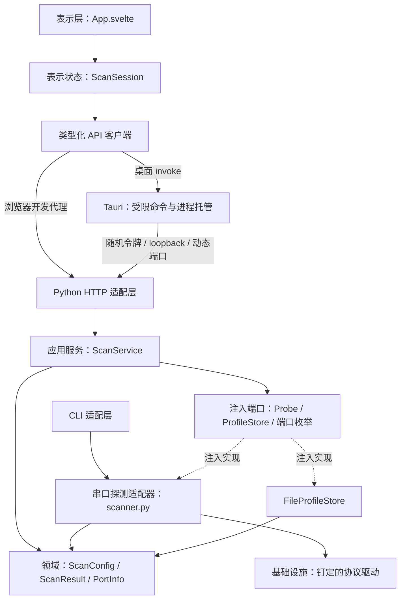
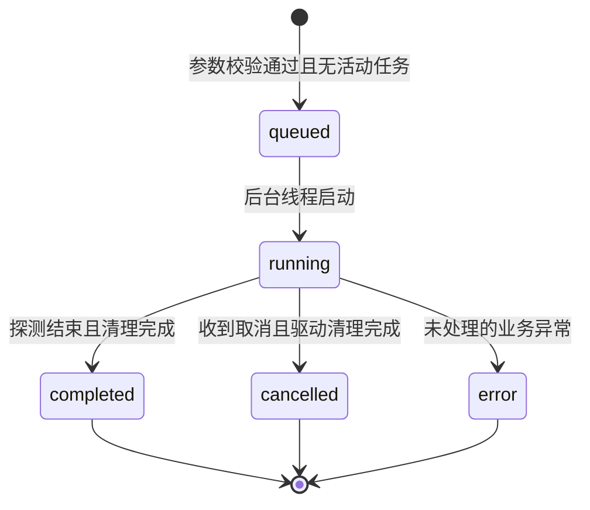

# 分层设计

目标：Svelte 展示与交互、Tauri 托管窗口和进程、Python 完整拥有扫描业务与数据。新增协议无需修改 Rust，替换界面无需重写串口逻辑。

## 各层约束

- **表示层**：`App.svelte` 只绑定状态与 DOM；`session.svelte.ts` 管理请求、轮询与自动复查。串口参数是否合法由 Python 最终判定。HTML 表单提供基础输入约束，状态样式使用统一颜色变量。
- **桌面层**：`main.rs` 启动随包冻结的 Python 业务进程，开发时启动虚拟环境中的业务包，等待 stdout 就绪消息后创建业务连接。只转发白名单方法与路径，异步命令把阻塞 HTTP 放到工作线程。Rust 不解释扫描结果、不访问串口。
- **接口层**：`api.py` 解析请求、验证访问令牌、映射 HTTP 状态并组装依赖；CLI 作为独立批处理入口复用相同领域配置与探测适配器。
- **应用层**：`application.py` 定义任务、互斥、取消和配置用例。通过 `Probe`、`ProfileStore` 与枚举函数注入基础设施，可用假驱动离线测试。任务记录最多 50 条，应用退出后不保留任务历史。
- **领域层**：`config.py` 和 `models.py` 无 HTTP、UI、串口依赖，表达校验约束与结果。
- **基础设施层**：`scanner.py` 处理协议级探测及状态判定，`_vendor/` 处理字节与串口，`profiles.py` 原子替换配置文件，`logging_setup.py` 轮转日志。

## 扫描生命周期

取消是请求：收到取消后任务仍为 `running`，直到当前有界读操作结束，驱动 `finally` 关闭串口并为已启动的 GS-CPA 输出发送 O0。已有完成状态不会被随后收到的取消改写。扫描结果中的 `error/offline/degraded` 是设备诊断状态；任务 `completed` 表示流程结束，不代表设备在线。

服务同时最多运行一个扫描或去皮测试，避免同一串口被重入；冲突返回 409。去皮测试复用相同的任务状态、取消和清理流程，但不触发自动复查。UI 提交请求时也立即锁定，防止双击。自动复查只在上一任务 `completed` 后排定，停止扫描时取消自动复查。失败的轮询继续重试，不丢弃活动任务。

## 进程生命周期与边界

1. 发布构建只运行主程序旁的 `rka-backend.exe`，缺失时页面显示原因，不回退到任何 Python 解释器。开发构建中显式设置 `RKA_PYTHON` 时使用该解释器，否则优先 sidecar，再回退至仓库 `.venv`，最后回退系统 Python。
2. 创建随机令牌并通过环境变量传给 Python，监听 `127.0.0.1:0`，由系统分配空闲端口。
3. Python 完成服务创建后向 stdout 输出 `{"port": number}`，诊断写 stderr/日志。Tauri 最多等 30 秒，包含冻结程序首次解压启动时间；启动失败清理子进程，原因写入 `~/.rka-comm-tester/logs/desktop.log`，窗口仍打开并在页面显示失败原因。窗口本身无法创建（如缺少 WebView2）时记录同一日志，Windows 上弹出系统错误框。
4. 页面通过 Tauri IPC 请求白名单接口，令牌保留在 Rust。Python 不开放跨域请求，并要求每个业务请求带令牌。
5. 退出时 Tauri 发送私有 shutdown 请求；Python 关闭服务、取消扫描并等待驱动清理。Tauri 等待进程结束，90 秒仍未退出才强制回收并输出诊断。

Tauri 以 `--exit-on-stdin-eof` 启动后端并在整个运行期间持有其 stdin 管道写端。桌面进程崩溃或被强制结束时，操作系统关闭该管道，Python 读到 EOF 后走与 shutdown 相同的收尾（取消扫描、等待驱动清理、关闭服务），不会遗留占用串口的后端进程。正常关闭走上述收尾流程；断电或后端自身被强制终止时仍无法保证 O0 发送成功。冻结服务仍使用相同 API、应用与领域模块，打包不复制另一套业务逻辑。PyInstaller onefile 的引导进程和实际服务进程由正常 shutdown 一起退出；CI 检查窗口退出后不存在遗留业务进程。

## 构建与交付边界

`scripts/backend_entry.py` 只进入 API 适配层。PyInstaller 收集协议模块，排除 Qt；`build_backend.py` 生成带 Rust target 后缀的 sidecar。Tauri 发布配置通过 `externalBin` 将它安装为 `rka-backend.exe`，附带依赖许可；默认开发配置保持无冻结依赖。

`stage_release.py` 将主程序、sidecar、许可与使用说明打包为 ZIP，并复制 NSIS 安装器、生成 SHA-256 校验文件。发布工作流调用同一个 Windows 检查/构建工作流；只有测试与安装/卸载检查全部成功，拥有 `contents: write` 的独立发布任务才上传 Release。分层依赖和构建工具互不混入运行时业务。详见 [发布约定](releasing.md)。

## 本地 JSON 接口

所有请求均须 `Authorization: Bearer <每次启动的随机令牌>`，POST 配置/扫描请求使用 `application/json`，最大 1 MB。只允许 loopback。

| 方法 | 路径 | 返回 |
|---|---|---|
| GET | `/api/health` | 服务名、活动扫描数、日志路径 |
| GET | `/api/ports` | 系统端口列表，不探测设备 |
| GET / POST | `/api/config` | 加载 / 校验并保存用户配置 |
| POST | `/api/scans` | 202 + 任务快照（`operation: "scan"`） |
| POST | `/api/tare` | 202 + 去皮测试任务快照（`operation: "tare"`）；仅电子天平，需页面确认 |
| GET | `/api/scans/{id}` | 任务类型、状态、配置快照和本轮结果（扫描与去皮共用） |
| POST | `/api/scans/{id}/cancel` | 请求取消，返回当前快照 |
| GET | `/api/log` | 当前日志文件名与 UTF-8 内容 |
| POST | `/api/shutdown` | 202，开始关闭；仅桌面进程使用，不向页面暴露 |

400：配置或请求无效；401：令牌缺失/错误；404：接口/任务不存在；409：活动扫描冲突；500：内部错误，详情进日志。

## 验证与扩展

Python 测试用注入的假驱动覆盖参数、协议、任务和 HTTP 边界，不访问真实串口。Svelte 类型检查和构建检查表示层；Windows CI 编译 Rust、打包、运行冻结后端和便携/安装版桌面生命周期检查。浏览器联调通过 Vite 的同源代理；CI 桌面冒烟只覆盖窗口、后端与退出收尾，真机协议、接线、界面完整交互与时间参数仍需现场确认。

新增设备时：扩展领域配置，新增 `scanner.py` 探测适配器及测试，再增加表单选项；保持 I/O 有界、取消检查与 finally 清理。无需新增 Rust 业务逻辑。
