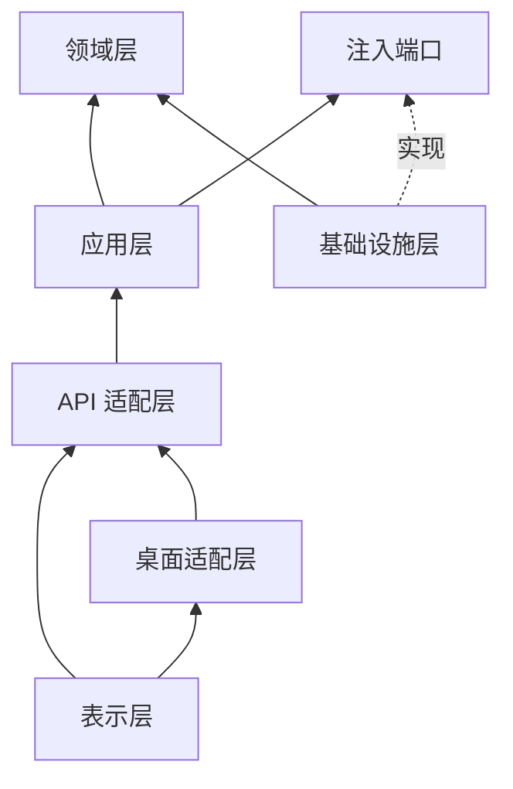

# 分层设计思路

分层的目标是让“窗口怎么画”“Python 服务怎么启动”和“设备帧怎么校验”彼此可替换。依赖只能从外层指向内层；协议驱动不依赖 Svelte、Tauri 或 HTTP，新增设备不需要修改 Rust。

## 六层职责

| 层 | 当前实现 | 允许依赖 | 不应承担 |
| --- | --- | --- | --- |
| 表示层 | `frontend/src/App.svelte`、`lib/session.svelte.ts` | 类型化 API 客户端、展示状态 | 串口、文件、协议帧和最终业务校验 |
| 桌面适配层 | `src-tauri/src/main.rs` | 操作系统进程/窗口能力、受限 API 转发 | 解释扫描结果、构造 Modbus/CPL/天平帧 |
| API 适配层 | `api.py`、`app.py` | 应用服务、JSON/HTTP/CLI 库 | 保存界面状态、直接操作串口 |
| 应用层 | `application.py` | 领域模型、注入的端口接口 | 依赖具体 HTTP、Tauri、pyserial 或厂商模块 |
| 领域层 | `config.py`、`models.py` | Python 标准库 | I/O、线程创建、日志后端和 UI 术语 |
| 基础设施层 | `scanner.py`、`profiles.py`、`logging_setup.py`、`_vendor/` | 领域值、串口/文件/日志实现 | 反向调用前端或桌面壳 |

这里的“端口”是 Python 的协议接口：`Probe`、`ProfileStore` 和端口枚举函数由应用服务声明，具体扫描器和文件存储在组合根注入。这样测试可以使用假探测器，发布包也能复用完全相同的应用代码。

## 依赖方向

箭头表示调用或实现关系。领域层不能导入 `serial`、`http.server`、Tauri、Svelte 或文件路径；应用层不能通过全局单例偷偷创建真实串口；表示层不能根据某个协议的寄存器值重新判定在线状态。

## 业务规则放置

- **输入规则**放在 `ScanConfig`：设备类型、端口、波特率、校验位、停止位、超时、地址和天平帧数都在进入应用服务前校验。UI 的 HTML 约束只是即时反馈，不能替代 Python 校验。
- **任务规则**放在 `ScanService`：一个服务实例同时只运行一个任务；取消只设置事件，任务状态在驱动清理后变为终态；历史最多 50 条。
- **协议规则**放在 `scanner.py` 和钉定驱动：TAIE 的 PV/SV、Azbil 的 CPL/量程、天平稳定帧和错误码都在基础设施边界内转为统一 `ScanResult`。
- **安全边界**放在 API 与桌面层：loopback、Bearer token、白名单 IPC、动态端口和进程退出策略不能由页面自行决定。
- **持久化规则**放在 `FileProfileStore` 和日志适配器：应用层只知道 `ProfileStore`，不关心 JSON 文件和轮转实现。

## 新增协议的步骤

1. 在 `_vendor/` 或独立基础设施模块中固定上游来源、许可证和提交，先写帧构建/解析测试。
2. 在 `scanner.py` 增加只读探测适配器，将超时、协议错误和可诊断的降级状态映射为 `ScanResult`。
3. 为 `ScanConfig` 增加最小必要参数和边界校验；不要把厂商寄存器常量放进 Svelte 或 Rust。
4. 通过 `ScanService` 的 `Probe` 注入假驱动覆盖取消、异常和资源清理，再补充真实帧样例测试。
5. 最后增加表示层选项和协议文档；若需要新的桌面能力，先确认它属于生命周期/IPC，而不是把业务逻辑移入 Rust。

## 测试对应关系

| 风险 | 主要验证 |
| --- | --- |
| 参数越界、错误设备组合 | `tests/test_config.py`、API 400 测试 |
| CRC、CPL 校验和、帧长度、地址回显 | `tests/test_protocol_frames.py` |
| PV/SV、实时量程、稳定重量判定 | `tests/test_scanner.py` |
| 取消时的驱动清理和任务终态 | `tests/test_api.py`、`tests/test_scanner.py` |
| loopback、token、请求体和错误状态 | `tests/test_api.py` |
| 冻结后端、窗口启动/退出、安装卸载 | `.github/workflows/checks.yml` 与冒烟脚本 |

## 需要避免的耦合

- 不在 Rust 中复制协议帧或直接打开串口；Rust 只管理 Python 进程和经过白名单的请求。
- 不在 Svelte 中根据 `pv_raw`、重量字符串或错误码做第二套判定；只渲染 Python 返回的状态和 detail。
- 不让 API handler 直接调用 `serial.Serial`；它只解析输入并调用应用服务。
- 不为了方便把真实端口、配置文件路径或全局 token 写成领域对象的默认值。
- 不在新增协议时顺手开放写入接口。扫描的只读边界必须由扫描器调用路径、UI、API 和测试共同保持；天平去皮测试是唯一例外，使用独立的 API、任务类型和操作员确认。

现有 [`docs/architecture.md`](architecture.md) 保留任务状态、进程生命周期和 JSON API 的细节；本文档负责解释为什么这些模块要这样分层。
