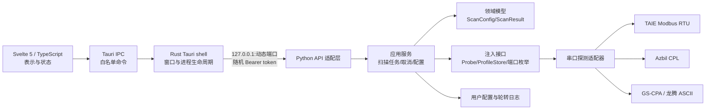
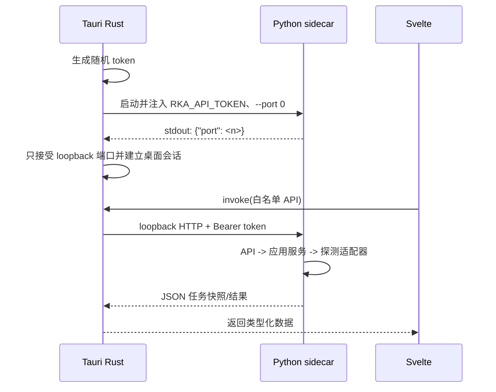
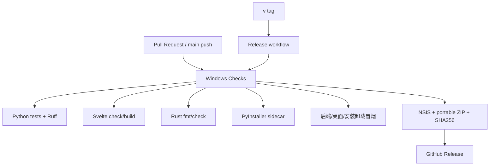

# 技术架构设计

RKA-3000 通信测试工具采用 Tauri 2 + Svelte 5/TypeScript 的桌面窗口，以及 Python 业务 sidecar。窗口负责交互和桌面生命周期，Python 负责配置、任务、协议驱动、日志和数据模型；Rust 不实现串口业务。

## 组件关系

源码映射如下：

| 组件 | 位置 | 责任 |
| --- | --- | --- |
| 窗口与状态 | `frontend/src/` | 表单、轮询、任务状态和结果展示 |
| 桌面壳 | `src-tauri/src/main.rs` | 启动/等待/关闭 Python，保存 token，转发受限 API |
| HTTP/CLI 适配 | `src/rka_comm_tester/api.py`、`app.py` | 解析请求、鉴权、状态码和依赖组装 |
| 应用服务 | `application.py` | 单任务互斥、取消、历史上限、配置用例 |
| 领域模型 | `config.py`、`models.py` | 参数约束、地址范围、结果结构 |
| 基础设施 | `scanner.py`、`profiles.py`、`logging_setup.py`、`_vendor/` | 串口 I/O、协议帧、配置文件和日志 |

## 进程启动与请求路径

启动时 Python 监听 `127.0.0.1:0`，由操作系统分配空闲端口，再通过 stdout 输出机器可读握手。Rust 最多等待 30 秒，启动失败会读取 stderr、终止子进程并把诊断留在日志中。开发环境可使用仓库 `.venv`；发布包优先使用旁路的 `rka-backend.exe`。

桌面 API 只转发固定的健康检查、端口枚举、配置、扫描、取消、日志和关闭操作。token 不进入前端 bundle；Python API 拒绝非 loopback 请求、缺失 token 和超过 1 MB 的 JSON 请求体。

## 扫描和关闭生命周期

1. Svelte 提交已填写的配置，Python 领域模型再次校验参数。
2. 应用服务在活动任务存在时返回冲突，否则创建任务并在线程中运行探测器。
3. 探测器在每个地址/帧之间检查取消事件；驱动的 `finally` 关闭串口并执行必要的 GS-CPA `O0`。
4. 任务只有在探测迭代器退出后才进入 `completed` 或 `cancelled`，结果和清理状态一起返回。
5. 退出窗口时 Tauri 调用私有 shutdown，Python 取消活动任务、等待资源清理并关闭 HTTP 服务；90 秒后才强制回收仍未退出的进程。

这套顺序把设备资源的所有权留在 Python，避免 Rust 或前端在取消期间直接触碰串口。进程崩溃、断电或外部强杀时，协议层无法保证最后一条清理命令送达，因此现场仍应使用硬件安全状态。

## 数据与安全边界

- 用户配置原子写入 `~/.rka-comm-tester/config.json`，日志写入同目录 `logs/communication.log`，按 5 MB 轮转并保留 3 个备份。
- Python 任务历史只保留最近 50 条，避免自动复查长期占用内存；任务结果为 JSON 快照，不作为持久化数据库。
- Rust 只保存当前会话 token 和子进程句柄；前端只持有类型化的业务响应，不读取进程环境变量。
- 串口协议的校验、地址、字数、量程和状态判定在 Python 驱动层完成；Svelte 只负责呈现，不复制判定逻辑。

## 构建、分发与 CI/CD

开发构建使用 Vite 和 Tauri dev，Python 直接来自 `.venv`。发布构建先用 PyInstaller 生成 `rka-backend-<target>.exe`，再由 Tauri `externalBin` 嵌入 NSIS 安装器和便携目录。`stage_release.py` 复制主程序、sidecar、第三方许可和使用说明，并生成 `SHA256SUMS.txt`。

检查工作流只读仓库内容并上传构建 artifact；发布工作流在标签验证成功后使用 `contents: write` 创建 Release。带 `-rc.N` 的标签自动标记为 prerelease，正式标签例如 `v0.1.0`。目前未配置 Authenticode，SHA-256 只验证下载完整性，不能代替代码签名。

更具体的本地命令、版本同步清单和发布故障处理见 [`docs/releasing.md`](releasing.md)。
